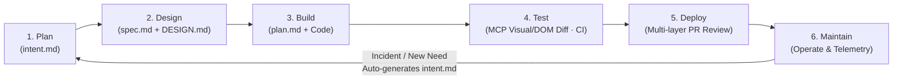
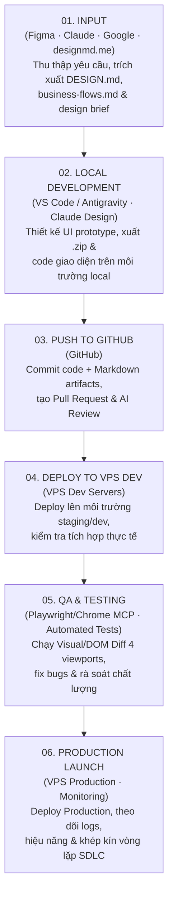

# AI-Native Design-to-Production Playbook (Anthropic SDLC × DesignMD × MCP Verification)

> **Mục tiêu cốt lõi:** Triệt tiêu hoàn toàn hiện tượng giao diện "mùi AI" (generic template, lệch tông với hệ thống cũ, vỡ bố cục responsive) bằng quy trình **AI-Native SDLC 6 Bước**, chuẩn hóa tài liệu **`DESIGN.md` + `business-flows.md`**, và cổng kiểm định tự động **Playwright / Chrome DevTools MCP (Visual Screenshot + DOM BoundingRect Diff)**.

---

## 1. Vòng Lặp 6 Bước AI-Native SDLC (Anthropic Playbook)

Mọi tính năng giao diện (từ dự án mới hoàn toàn đến thêm module vào hệ thống có sẵn) đều đi qua 6 giai đoạn khép kín, mỗi giai đoạn xuất ra một **Markdown Artifact** được lưu vết qua Git:



| Giai đoạn | Artifact Đầu Ra | Vai Trò Của Con Người & AI Agent |
|-----------|-----------------|----------------------------------|
| **1. Plan (Lập kế hoạch)** | `intent.md` | Tổng hợp nỗi đau/yêu cầu thực tế từ người dùng, định hình bài toán (proto-spec). |
| **2. Design (Thiết kế)** | `spec.md`, `DESIGN.md`, `business-flows.md`, `<feature>-design.zip` | Gộp Requirements + Design System + Luồng nghiệp vụ trong 1 phiên chuẩn hóa theo skill của tổ chức. |
| **3. Build (Xây dựng)** | `plan.md` + `code` | Agent lập kế hoạch thực thi (`plan.md`), con người duyệt kiến trúc trước khi code; `CLAUDE.md` / `AGENTS.md`, skills và hooks đóng vai trò lan can bảo vệ (guardrails). |
| **4. Test (Kiểm thử)** | `evals · CI · MCP Diff Report` | Mỗi phiên tự kiểm thử bằng **Playwright / Chrome DevTools MCP** (so sánh ảnh chụp màn hình + tọa độ DOM ở 4 viewport), tự động sửa lỗi lệch giao diện trước khi bàn giao. |
| **5. Deploy (Triển khai)** | `PR Review` | Agent rà soát đa tầng (UI/UX, Security, Performance); con người chỉ phê duyệt các thay đổi trọng yếu. |
| **6. Maintain (Vận hành)** | `intent.md` (mới) | Giám sát logs & trải nghiệm thực tế; khi phát sinh sự cố hoặc nhu cầu nâng cấp, tự động sinh `intent.md` mới để khép kín vòng lặp về Bước 1. |

---

## 2. Cấu Trúc Thư Mục Tài Liệu Chuẩn Dự Án (`docs/01..06`)

Trước khi thiết kế hoặc code thêm tính năng mới vào một dự án đang chạy, hãy tổ chức (hoặc đọc) thư mục `docs/` theo chuẩn đánh số để AI Agent luôn nắm trọn ngữ cảnh hệ thống:

```text
project-root/
├── CLAUDE.md / AGENTS.md          # Quy tắc bất khả xâm phạm & Guardrails của dự án
├── docs/
│   ├── 01-tong-quan/              # intent.md, tầm nhìn sản phẩm, đối tượng người dùng
│   ├── 02-ky-thuat/
│   │   ├── architecture.md        # Kiến trúc hệ thống, tech stack, database schema
│   │   ├── business-flows.md      # Luồng nghiệp vụ hiện có (QT-01, QT-02...) kèm sơ đồ Mermaid
│   │   └── <feature-tech-spec>.md # Đặc tả kỹ thuật của tính năng mới (VD: chatbot-zalo.md)
│   ├── 03-san-pham/               # spec.md, PRD, user stories
│   ├── 04-van-hanh/               # Hướng dẫn deploy VPS Dev/Prod, CI/CD, monitoring
│   ├── 05-mau/                    # Templates chuẩn của dự án
│   ├── 06-design/
│   │   ├── DESIGN.md              # Hệ thống Design Tokens chuẩn (trích xuất từ designmd.me / app gốc)
│   │   └── <feature>-design.zip   # Bản thiết kế HTML/CSS/Assets xuất từ Claude Design / Figma
│   └── 99-ghi-chu/                # Nhật ký quyết định (ADR), ghi chú phát sinh
```

### Quy chuẩn viết `business-flows.md` (Truy vết từ Source Code thực tế)
- Mỗi quy trình nghiệp vụ được đánh mã rõ ràng (`QT-01`, `QT-02`, `QT-03`...):
  - **Ví dụ:** `QT-01: Xác thực & Thiết lập ban đầu`, `QT-02: Quản lý phiên đăng nhập`, `QT-03: Quản lý mật khẩu`, `QT-04: Không gian làm việc & Thành viên`...
- Mỗi quy trình bao gồm: **Mục đích**, **Các bước thực hiện (Step-by-step)**, **Sơ đồ Mermaid (`sequenceDiagram` / `flowchart`)**, và **File mã nguồn liên quan (Backend/Frontend)** để khi thiết kế UI mới không bao giờ bị lệch luồng dữ liệu.

---

## 3. Trích Xuất & Chuẩn Hóa `DESIGN.md` (DesignMD Workflow)

Khi bắt đầu dự án từ con số 0 hoặc cần đồng bộ thiết kế với một website mẫu / hệ thống sẵn có:

1. **Cách 1 — Trích xuất từ Website bất kỳ qua [designmd.me](https://designmd.me)**:
   - Nhập URL website mẫu (VD: `linear.app`, `stripe.com`, `notion.so`, `apple.com`, hoặc URL sản phẩm hiện tại).
   - Chọn chế độ quét Single Page hoặc Multi-page để xuất ra file **`DESIGN.md`** kèm **Live HTML Preview** và **One-click Figma Import**.
2. **Cách 2 — Trích xuất trực tiếp từ Source Code / URL bằng Chrome DevTools MCP hoặc `ui-ux-pro-max`**:
   - Nếu dự án đã có frontend, quét `tailwind.config.*`, `globals.css`, hoặc dùng MCP đọc `getComputedStyle` trên trang thực tế để lập file `docs/06-design/DESIGN.md`.
   - Nếu dự án mới hoàn toàn chưa có mẫu, chạy công cụ `ui-ux-pro-max`:
     ```bash
     python d:/Antigravity/_agent/.shared/ui-ux-pro-max/scripts/search.py "<product_type> <industry> <keywords>" --design-system --persist -p "Project Name"
     ```

### Cấu trúc bắt buộc của `docs/06-design/DESIGN.md`
- **Brand & Aesthetic Direction**: Tông chủ đạo, cảm xúc thiết kế, đối tượng người dùng.
- **Color Tokens (Light & Dark Mode)**: Background (`--bg-primary`, `--bg-surface`, `--bg-elevated`), Text (`--text-primary`, `--text-secondary`, `--text-muted`), Accent/Brand (`--primary`, `--primary-hover`), Semantic (`--success`, `--warning`, `--danger`), Border (`--border`).
- **Typography Scale**: Font family (Heading, Body, Mono), kích thước (`xs` → `4xl`), `line-height`, `letter-spacing`, `font-weight`.
- **Spacing & Layout Tokens**: Hệ lưới 8pt (`4px`, `8px`, `12px`, `16px`, `24px`, `32px`, `48px`, `64px`), `max-width` container, `border-radius`, `box-shadow`.
- **Component Specifications**: Quy chuẩn Button, Input, Card, Table, Badge, Modal, Sidebar/Navbar, Skeleton Loader.

---

## 4. Mẫu Prompt Chuẩn Khi Thiết Kế Giao Diện (Claude Design / Figma / Generative UI)

Khi yêu cầu AI (Claude Design với model Opus + nạp Custom `Design System`, hoặc Antigravity Agent) tạo bản thiết kế UI cho tính năng mới dựa trên `DESIGN.md` và `business-flows.md`, luôn áp dụng cấu trúc **5 Ràng Buộc Vàng** sau:

```markdown
Hãy thiết kế giao diện cho tính năng [@docs/02-ky-thuat/<feature>.md] đồng bộ hoàn toàn với hệ thống [@docs/06-design/DESIGN.md] và luồng nghiệp vụ [@docs/02-ky-thuat/business-flows.md]:

1. Responsive:
   - Tương thích hoàn hảo trên cả Desktop (1440px, 1024px) và Mobile/Tablet (768px, 375px).
   - Không bị tràn ngang (no horizontal scroll), tự động chuyển đổi Sidebar/Table sang Drawer/Card view hợp lý trên Mobile.

2. Bố cục (Layout):
   - Tuân thủ chặt chẽ cấu trúc các thành phần, khoảng cách (8-point spacing grid) và tỷ lệ phân cấp thị giác như trong DESIGN.md.

3. Màu sắc (Colors & Theme Parity):
   - Sử dụng chính xác 100% các mã màu (hex/CSS variables) đã định nghĩa trong DESIGN.md cho cả Light Mode và Dark Mode. Tuyệt đối không tự ý sinh màu lệch hệ thống.

4. Components:
   - Chia nhỏ thành các component hợp lý, độc lập, dễ bảo trì và tái sử dụng (Buttons, Inputs, Cards, Modals, Data Tables, Status Badges).

5. Trạng thái & Tương tác (States & Micro-interactions):
   - Thêm đầy đủ hiệu ứng hover, focus-visible, active, disabled cho tất cả buttons/links/inputs.
   - Xử lý đóng/mở mượt mà (150-250ms ease-out) cho các menu, dropdown, modal, tab, form.
   - Bổ sung đầy đủ các trạng thái thực tế: Loading (Skeleton), Empty State, Error State, và Success Feedback.
```

---

## 5. Cổng Kiểm Định Pixel-Perfect Bằng Playwright / Chrome DevTools MCP (Design-to-Code Gate)

Sau khi có bản thiết kế chuẩn (ví dụ gói HTML/CSS mẫu `@docs/06-design/<feature>-design.zip` hoặc bản mẫu Figma/HTML) và chuyển sang code thực tế (React / Next.js / Vue / Tailwind) trong thư mục `@<frontend-dir>`, Agent **BẮT BUỘC** thực hiện quy trình kiểm định tự động bằng **Playwright MCP** hoặc **Chrome DevTools MCP** (`chrome-omnichannel-mcp`):

### Prompt Kích Hoạt Chuẩn:
> *"Hãy giúp tôi code giao diện từ `@docs/06-design/<feature>-design.zip` vào thư mục `@<frontend-dir>` dùng MCP Playwright / Chrome DevTools để kiểm tra giao diện, so sánh nếu lệch hay có vấn đề thì căn chỉnh lại cho khớp 100%."*

### 4 Bước Kiểm Định Tự Động Bắt Buộc Của Agent:

1. **Mount Song Song Bản Thiết Kế Gốc & Bản Code Thực Tế**:
   - Giải nén và phục vụ bản thiết kế gốc (HTML/CSS tĩnh) song song với dev server của ứng dụng (`localhost:<port>`).
2. **So Sánh Ảnh Chụp Màn Hình Trực Quan (Visual Screenshot Comparison)**:
   - Dùng MCP mở từng trang / từng tab chức năng (VD: Home, Shared Inbox, AI Agent, Connected Channels...) ở cả **Light Mode** và **Dark Mode**.
   - Chụp screenshot đối chiếu trực tiếp để phát hiện ngay lỗi lệch màu, thiếu icon, sai font, mất đường viền (`border`) hoặc lệch căn chỉnh.
3. **So Sánh Tọa Độ DOM & BoundingRect Trên 4 Mốc Viewport (DOM Coordinate Diff)**:
   - Chạy script kiểm định [`scripts/dom_diff_audit.js`](scripts/dom_diff_audit.js) qua `chrome_evaluate_js` / Playwright trên cả bản gốc và bản React/Vue ở **4 kích thước màn hình chuẩn**:
     - Mobile: `375px`
     - Tablet: `768px`
     - Laptop: `1024px`
     - Desktop: `1440px`
   - Trích xuất danh sách phần tử `{ tag, text, rect: { x, y, width, height }, styles: { color, backgroundColor, border, fontSize, fontWeight } }`, sắp xếp và chạy `diff` để bắt chính xác mọi sai lệch kích thước/vị trí dù chỉ vài pixel.
4. **Chủ Động Sửa Lỗi Bản Gốc & Kiểm Tra Production Build**:
   - Nếu phát hiện lỗi cú pháp CSS/HTML tiềm ẩn trong chính bản thiết kế gốc (ví dụ dư dấu nháy kép `border: 1px solid var(--border)"` khiến trình duyệt bỏ qua thuộc tính `border`), Agent phải chủ động sửa đúng trong code React/Vue và **ghi chú rõ trong báo cáo bàn giao (Intentional Fixes/Differences)**.
   - Chạy `npm run build` (hoặc tương đương) đảm bảo build sạch 100%, không lỗi TypeScript/ESLint, kiểm tra dung lượng bundle (JS/CSS) tối ưu trước khi kết thúc.

---

## 6. Quy Trình 6 Bước "Từ Figma/Design → Production" (Design Master Workflow)

Quy trình tổng thể giúp đội ngũ Dev & Designer tiết kiệm **70% thời gian** triển khai sản phẩm thực tế:


